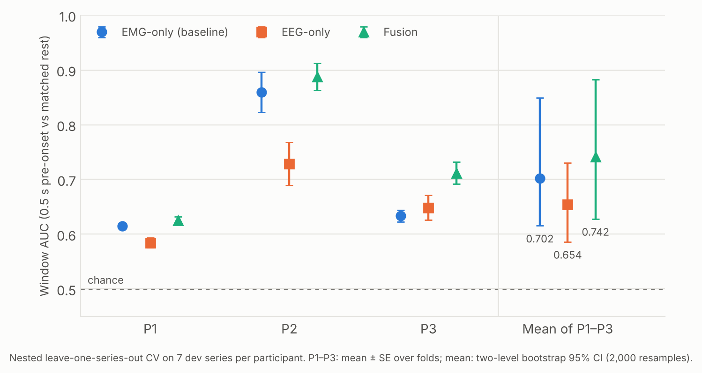

# Reach or Cue?

*Causal EEG / EMG reach-onset detection*

### ESE 5420 - Statistics for Data Science &nbsp;·&nbsp; University of Pennsylvania

**Bokang Ding** &nbsp;·&nbsp; Team Dyn (Solo)

Does EEG detect the reach, or the cue? This project asks whether EEG lets a detector recognise an upcoming reach earlier than EMG alone when every detector is strictly causal and held to the same false-alarm rate, and whether any extra lead follows the movement or the visual go cue. It uses the public WAY-EEG-GAL grasp-and-lift dataset, with hand start from 3-D hand kinematics as an answer key independent of both signals.

> **Status: in progress.** All 12 participants, development series only; the test series have not been opened. The pseudo-online detector, the cue references and the slope test are implemented, and their results will be added once the test series are scored.

<p align="center">
  
  <br>
  <b>Fig. 1.</b> Window AUC (0.5 s before hand start vs. matched rest) on held-out development series. P1–P12: mean ± SE over 7 folds; mean: two-level bootstrap 95% CI.
</p>

## Results (preliminary)

Nested leave-one-series-out cross-validation on 7 development series per participant.

| | EMG-only (baseline) | EEG-only | Fusion | Fusion − EMG |
| :-- | :-: | :-: | :-: | :-: |
| **Mean of P1–P12 (95% CI)** | 0.708 [0.669, 0.751] | 0.652 [0.619, 0.686] | 0.742 [0.704, 0.785] | +0.034 [0.017, 0.052] |

Fusion is above EMG-only for all 12 participants (paired sign-flip test over all 4,096 sign patterns, p = 0.0005), and EEG-only is below EMG-only for 10 of 12 (p = 0.015). Per-participant values are in Fig. 1.

The choice of rest windows matters. When rest is taken from all inter-trial time, most of it comes from the long waits of the surface and mixed series, and EEG partly learns "long wait vs. near a reach" rather than movement preparation. Rest is therefore taken from the 1 s before each LED onset in every series.

## Pipeline

The data come from [WAY-EEG-GAL](https://doi.org/10.6084/m9.figshare.988376) (Luciw et al., 2014): 12 participants, 3,936 grasp-and-lift trials, `32`-channel EEG and hand kinematics at `500 Hz`, and `5`-channel EMG at `4 kHz`.

- **Alignment** ([`data.py`](reach_or_cue/data.py)). Event times are relative to a window that starts `2 s` before LED onset, so series time = `StartTime − LEDOn + event`, checked against the recorded LED channel (within `2 ms`).
- **Labels** ([`data.py`](reach_or_cue/data.py)). A decision every `50 ms`. Positive: the `0.5 s` before hand start. Rest: the `1 s` before each LED onset, at least `0.5 s` after the previous hand stop. Lifts with reaction time below `0.1 s` are excluded.
- **Features** ([`features.py`](reach_or_cue/features.py)). All filters are causal. EMG: `20 Hz` high-pass, rectification, `5 Hz` envelope, log, at lags `0` and `100 ms`. EEG: common average reference, `0.05–5 Hz` slow potentials on seven central channels at lags `0–400 ms`, and μ/β log power on C3, Cz, C4. Fusion concatenates both.
- **Model** ([`evaluation.py`](reach_or_cue/evaluation.py)). Standardization and L2 logistic regression with balanced class weights; `C` chosen by inner leave-one-series-out CV within each training fold.
- **Split** ([`data.py`](reach_or_cue/data.py)). Per participant, the last weight series and the last surface/mixed series are held out as the test set and used once. The other 7 series are cross-validated one series at a time.
- **QC** ([`qc.py`](reach_or_cue/qc.py)). Hand speed, EMG envelopes and slow potentials averaged around hand start, one figure per participant.
- **Cue-only reference** ([`merge_participants.py`](scripts/merge_participants.py)). Scores each decision time by whether the trial's LED is lit, with no training, and compares all detectors by paired sign-flip tests across participants.
- **Pseudo-online detection** ([`online.py`](reach_or_cue/online.py), [`pseudo_online.py`](scripts/pseudo_online.py)). Each detector scores every `50 ms`; a trigger is an upward threshold crossing, followed by a `1 s` refractory period. Thresholds are set on out-of-fold training scores for at most `1` false alarm per minute, counted over all inter-trial time. A reach counts as detected if a trigger falls within `[−1.0, +0.15] s` of hand start (`[−0.5, +0.1] s` as a check). References: a timer that fires a fixed delay after LED onset, and a random detector with the same trigger rate.
- **Slope test** ([`online.py`](reach_or_cue/online.py)). The latency of the first trigger after LED onset is regressed on reaction time, censored at `2 s`: a slope of `0` means the detector follows the LED, `1` that it follows the hand. The estimator is checked on simulated cue-locked and movement-locked streams. [`pseudo_online_followup.py`](scripts/pseudo_online_followup.py) adds operating curves and repeats the test at looser thresholds.
- **Gao et al. (2026) protocol** ([`gao_protocol_timer.py`](scripts/gao_protocol_timer.py)). The LED timer scored under the event protocol of Gao, Cao and Ma (*IEEE Access*, 2026), for a like-for-like comparison with their per-participant results.

## Quickstart

Requires **Python 3.12+**:

```bash
git clone https://github.com/bkding/reach-or-cue.git
cd reach-or-cue
python3 -m venv .venv
source .venv/bin/activate        # Windows: .venv\Scripts\activate
pip install -e .
```

Download the participant archives (`P1.zip`, ...) from [figshare](https://doi.org/10.6084/m9.figshare.988376) into `data/zips/`, and extract `HS_P#_S1.mat` to `HS_P#_S9.mat` and `P#_AllLifts.mat` into `data/P#/`.

**Data check** (alignment, reaction times, rest minutes, QC figures):

```bash
python scripts/run_baseline.py data --participants 1,2,3 --check-only --out results/check
```

**Baseline** (nested CV for EMG, EEG and fusion, one participant at a time; about 30 s each on a CPU), then the cue-only reference and paired tests:

```bash
for p in 1 2 3 4 5 6 7 8 9 10 11 12; do
  python scripts/run_baseline.py data --participants $p --out results/baseline/P$p
done
python scripts/merge_participants.py data results/baseline
python scripts/plot_baseline.py results/baseline/baseline_auc_errorbars.csv results/baseline/baseline.png
```

Add `--rest all` to use all inter-trial time as rest instead of matched rest.

**Pseudo-online detection and slope test** (each stage caches per participant; about 7 min for all 12):

```bash
for stage in score evaluate summarize; do
  python scripts/pseudo_online.py data results/baseline --out results/pseudo_online --stage $stage
done
python scripts/pseudo_online_followup.py results/pseudo_online --out results/followup --stage compute
python scripts/pseudo_online_followup.py results/pseudo_online --out results/followup --stage summarize
```

**LED timer under the Gao et al. protocol** (reads the trial windows from the original archives):

```bash
python scripts/gao_protocol_timer.py data data/zips --out results/gao_timer
python scripts/gao_protocol_timer.py data data/zips --out results/gao_timer --summarize-only
```

## Roadmap

- [x] Alignment, causal features, matched rest, nested-CV baseline (P1–P3)
- [x] All 12 participants, with a cue-only reference (development series)
- [x] Pseudo-online detector at 1 false alarm per minute, with an LED timer, a rate-matched random detector and operating curves (development series)
- [x] Slope test: do detections follow the hand or the LED? (development series)
- [ ] EEG: separate LED-locked and movement-locked components by regression-based deconvolution
- [ ] Test series, scored once, with paired sign-flip tests across participants

## Acknowledgements

Data: M. D. Luciw, E. Jarocka and B. B. Edin, "Multi-channel EEG recordings during 3,936 grasp and lift trials with varying weight and friction," *Scientific Data* 1, 140047 (2014), CC BY 4.0.
